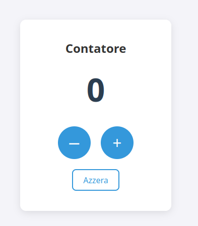

# Contatore

**▶ Prova l'applicazione: [francescoingallati.github.io/contatore-js](https://francescoingallati.github.io/contatore-js/)**

Applicazione web che funziona come un contatore: l'utente può aumentare, diminuire o azzerare il valore tramite tre pulsanti. Il valore viene salvato automaticamente nel browser e ripristinato alla riapertura della pagina.

Progetto realizzato in JavaScript puro, senza librerie né framework: l'intera interfaccia viene generata dinamicamente tramite la manipolazione del DOM.



## Funzionalità

- **Incremento e decremento** del valore con i pulsanti `+` e `−`
- **Valore iniziale a 0** alla prima apertura della pagina
- **Pulsante Azzera** per riportare il contatore a 0, con uno stile secondario per distinguerlo dalle azioni principali
- **Salvataggio automatico** del valore con `localStorage`: ricaricando o riaprendo la pagina il conteggio viene mantenuto
- **Accessibilità**:
  - pulsanti utilizzabili da tastiera (Tab per spostarsi, Invio o Spazio per attivarli), con un contorno di focus visibile
  - etichette `aria-label` sui pulsanti `+` e `−`, così gli screen reader leggono la loro funzione e non il simbolo
  - il valore è una regione `aria-live`, quindi ogni cambiamento viene annunciato agli screen reader
- **Uso da mobile**: il doppio tocco rapido non attiva lo zoom della pagina.

## Tecnologie

- **HTML5**: un solo contenitore vuoto (`<div id="app">`), riempito da JavaScript
- **CSS3**: variabili CSS (custom properties) per i colori, layout con Flexbox, pseudo-classi `:hover`, `:active` e `:focus-visible`
- **JavaScript (ES6+)**: creazione degli elementi con `document.createElement`, gestione degli eventi con `addEventListener`, persistenza dei dati con `localStorage`

## Struttura del progetto

```
contatore-js/
├── index.html      # struttura della pagina
├── style.css       # stile dell'interfaccia
├── script.js       # logica del contatore e creazione del DOM
├── screenshot.png  # anteprima dell'applicazione
└── README.md
```

## Come funziona

- All'avvio il valore viene letto da `localStorage` e convertito in numero con `Number()`. Alla prima visita non c'è ancora nessun valore salvato: `getItem` restituisce `null` e `Number(null)` vale `0`, quindi il contatore parte da 0 senza bisogno di controlli aggiuntivi.
- Tutti gli elementi dell'interfaccia vengono creati con una funzione di supporto, `buildElement`, che evita di ripetere lo stesso codice per ogni elemento.
- Ogni modifica del valore passa da un'unica funzione, `updateDisplay`, che aggiorna il numero a schermo e lo salva. In questo modo visualizzazione e salvataggio non possono mai andare fuori sincrono.

## Provarla in locale

1. Clona il repository:
   ```bash
   git clone https://github.com/francescoingallati/contatore-js.git
   ```
2. Apri il file `index.html` nel browser.

Non servono installazioni né dipendenze.

## Autore

Francesco Ingallati — [GitHub](https://github.com/francescoingallati)
